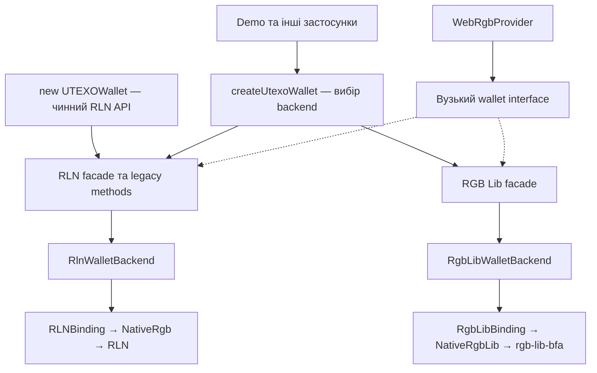

**План реалізації двох бекендів для UTEXO Wallet**

Додати `rgb-lib-bfa` як альтернативний on-chain бекенд у `@utexo/rgb-sdk-rn`, зберегти чинний RLN API та локалізувати перехід `rgb-sdk-rn-demo` у шарі відкриття й обслуговування гаманця. Обидві native бібліотеки мають працювати в одному застосунку; конкретний instance гаманця використовує один бекенд.

Цільова версія `rgb-lib-bfa`: `v0.3.0-beta.7-upstream-dev-bfa.1`, commit `ad87acb673262dbc0f2270b5b2e2f0d3db74a65a`. Вихідний стан RN SDK: commit `41ff170`, package `1.0.0-beta.39`, native RLN `0.17.0-beta.3`, core `1.0.0-beta.9`.

**1. Межі реалізації.** Перша поставка включає native підтримку двох бекендів, спільні on-chain операції, BFA receive/burn/consignment для перевірених інтеграцій, локальний backup/restore, lifecycle та вибір окремих профілів у demo.

Збереження API означає збереження назв, параметрів і результатів наявних підтримуваних операцій. Відмінності у fee rate, доступних функціях та форматах даних фіксуються явно. Підтримка нового бекенда не означає автоматичної сумісності існуючих asset contracts, proxy, backup або database.

До першої поставки не входять автоматичне перенесення RLN database, Lightning через `rgb-lib`, новий multisig UI, mint UI та підключення зовнішнього PSBT signer. Архітектура залишає для них точки розширення. Remote VSS та message signing для `rgb-lib` залишаються недоступними, поки не реалізовано й не перевірено їхні окремі контракти; чинні RLN-функції зберігаються.

**2. Головні архітектурні правила.** Публічний on-chain API працює з моделями SDK. Native типи, `Online`, wallet IDs, UniFFI enums і platform-specific errors залишаються всередині адаптерів.

- Один instance має незмінні backend, network, identity та storage path.
- Одна активна сесія володіє native handle і послідовним виконанням операцій.
- Lifecycle, feature support, готовність до операції та стан конкретного transfer — різні поняття.
- Типізована конфігурація не дозволяє передати RLN signer у `rgb-lib`.
- Усі грошові перетворення перевіряють точність до native виклику.
- Помилка читання wallet state не запускає видалення, перегенерацію чи створення нового гаманця.
- Виклик, який міг виконати broadcast, не повторюється автоматично.
- SDK не зберігає application preferences і не залежить від Expo, WalletConnect UI або SecureStore.
- Оновлення SDK не змінює обраний бекенд, ключі, storage path чи WalletConnect account існуючого RLN-профілю.

**3. Розподіл відповідальності.** Спільний facade реалізує назви методів, перевірки загальних параметрів та доступ до feature objects. Він делегує операції backend adapter. Перетворення native API і моделей виконує адаптер.



| Компонент | Відповідальність |
| --- | --- |
| `rgb-sdk-core` | Моделі, спільний on-chain контракт, capability interfaces, помилки, conformance suites |
| RN facade | Стабільний публічний API, загальна валідація, compatibility aliases |
| Backend adapter | Native lifecycle, defaults бекенда, signer integration, request/response mapping |
| Session executor | Послідовність операцій, завершення сесії, доступ до handle |
| Native bridge | Типізований transport, native resources, точні integers, structured errors |
| `BurnOperations` | Durable journal і відновлення невизначеного результату burn |
| `WebRgbProvider` | Авторизація, approvals, WebRGB DTO/errors, список доступних методів |
| Demo service | Профілі, credentials provider, UI state, переключення, WalletConnect sessions |

Не повертати `RLNRgbLibBinding extends RNRgbLibBinding`. Бекенди використовують композицію та спільний контракт. Не додавати `if (backend === ...)` у кожен публічний метод; вибір реалізації відбувається у фабриці.

**4. Публічний API та сумісність TypeScript.** Чинний `UTEXOWallet` залишається експортованим класом RLN із тим самим конструктором. Його внутрішня реалізація переходить на композицію з `RlnWalletBackend`. Зберігаються `instanceof`, публічні методи, exports та можливість використовувати клас як тип.

Новий `createUtexoWallet()` — синхронна фабрика: створює об'єкт, але не читає credentials, не відкриває native wallet і не підключається до мережі. `init()` та `unlock()` залишаються явними. Наявний `createWallet()` продовжує генерувати ключі; його значення не змінюється.

Нижче схема нових декларацій; повні interfaces міститимуть існуючі доменні типи.

```ts
type WalletBackendKind = 'rln' | 'rgb-lib';

type RlnWalletInit = {
  backend: 'rln';
  params: UTEXOWalletNodeParams;
  signer: IRLNSigner;
};

type RgbLibWalletInit = {
  backend: 'rgb-lib';
  params: RgbLibWalletParams;
  keys: IRgbLibKeyProvider;
};

type WalletInit = RlnWalletInit | RgbLibWalletInit;
type AnyUtexoWallet = UTEXOWallet | RgbLibWalletApi;

declare function createUtexoWallet(input: RlnWalletInit): UTEXOWallet;
declare function createUtexoWallet(input: RgbLibWalletInit): RgbLibWalletApi;
declare function createUtexoWallet(input: WalletInit): AnyUtexoWallet;
```

Фабрика повертає RLN-клас для `rln` і окремий тип facade для `rgb-lib`. Обидва реалізують однакові підтримувані on-chain методи. У `RgbLibWalletApi` немає flat Lightning methods. Discriminant `wallet.backend` звужує union, якщо застосунку потрібна конкретна реалізація.

Це дозволяє зберегти чесний `IUTEXOProtocol`: він продовжує описувати повний RLN-контракт. Не оголошувати, що `rgb-lib` реалізує його через набір методів, які лише кидають помилки.

У core виділити `IOnchainWalletCore` через композицію існуючих `IBitcoinWallet`, `IRgbAssets`, `IOnchainTransfers`, плюс наявні `getNetwork`, history, sync/refresh і локальний backup. `IOnchainWallet<TUnlockParams>` додає до нього `IWalletLifecycle<TUnlockParams>`. Наявні `IUTEXOProtocolCore` та `IUTEXOProtocol` перевикористовують відповідні контракти і зберігають весь попередній required surface. Нові identity methods не стають required для існуючих web або сторонніх implementations: вони належать RN-розширенню або окремому optional interface. RN-specific `shutdown`, `reinit`, detailed refresh та інші extras також залишаються RN-розширенням.

Не переносити всі можливі методи в один великий `IWalletBackend`. Внутрішній контракт складається з lifecycle, Bitcoin, RGB/history та optional feature ports. Спільний facade агрегує ці порти.

**5. Config і credentials.** Розділити серіалізовані параметри профілю та живі credential providers.

`RgbLibWalletParams` містить `network`, `storageDirPath`, `reuseAddresses`, `maxAllocationsPerUtxo` та явно обраний `witnessVersion`. Для початкового сумісного профілю використовувати Taproot; перевірити derivation fixtures для vanilla і colored account, keychain та fingerprint.

`RgbLibUnlockParams` містить явний `indexer` discriminated union для Electrum, Esplora або Bitcoind, `proxyEndpoint` і `evmRpcUrls: Record<string, string>`. Chain ID передається decimal string і перевіряється як `u64`. RPC credentials та proxy auth належать runtime-конфігурації, не публічному profile metadata.

Для простого переходу дозволити сумісний варіант `indexerUrl` у новому unlock API. Adapter має перетворювати його за документованими правилами; одночасне використання `indexer` та `indexerUrl` відхиляється. Новий API рекомендує явний тип indexer. Legacy RLN конфігурація зберігається без змін.

`ethRpcUrl` не переводиться в EVM map з вигаданим chain ID. Demo має передати обидва значення. Якщо потрібен compatibility helper, він отримує chain ID від RPC і перевіряє його перед використанням. Перевага надається явній конфігурації.

`IRLNSigner`, `PasswordRLNSigner` і `NativeExternalRLNSigner` зберігаються. Новий `IRgbLibKeyProvider` надає ключі для створення або повторного відкриття wallet; він не називається PSBT signer, оскільки підпис виконує native `Wallet`.

Початковий provider отримує mnemonic через callback застосунку під час відкриття сесії. Для demo callback читає SecureStore. SDK не має власної залежності від SecureStore та не перетворює RLN password на удаваний пароль блокування `rgb-lib`.

Native adapter виводить `SinglesigKeys` через `restore_keys` потрібної версії бібліотеки з explicit network/witness version. Перед відкриттям існуючих даних перевіряє fingerprint та account keys. RLN-specific перетворення seed зі скороченням до 32 байтів не використовується як BIP39 derivation для RGB Lib.

Native `Wallet` тримає потрібні ключі протягом сесії. `shutdown` звільняє їх настільки, наскільки це підтримує native API; наступний `reinit` повторно викликає provider. JS strings не дають гарантії zeroization, тому не обіцяти її; мінімізувати час утримання та виключити credentials із logs/errors/metadata.

Зовнішній signer надалі реалізує окремий PSBT signing port і використовує watch-only wallet із begin/sign/end. RLN signer до цього port автоматично не адаптується.

**6. Lifecycle і послідовність операцій.** Внутрішня сесія має стани `new`, `opening`, `offline`, `connecting`, `online`, `stopping`, `stopped`, `disposing`, `disposed`. Помилка операції не є станом transfer або автоматичною ознакою пошкодження всього wallet.

| Виклик | Семантика |
| --- | --- |
| Constructor/factory | Тільки конфігурація та композиція |
| `init()` | Створити або відкрити власний wallet state; без мережі |
| `unlock(params)` | Підключити backend та перевірити online configuration |
| `shutdown()` | Заборонити нові операції, завершити поточні, зберегти state, зупинити сесію |
| `reinit(params?)` | Відкрити зупинену сесію; підключитися, якщо передані params |
| `dispose()` / `destroy()` | Завершити сесію та звільнити handles; instance стає terminal |

Concurrent `init`, `unlock` і `dispose` приєднуються до відповідного in-flight promise. Після невдалого `init` сесія залишається retryable, якщо всі створені ресурси звільнені. Вже відкритий wallet приймає повторний `init` без повторної генерації ключів. Зміна online-конфігурації потребує контрольованого restart, а не прихованого перепідключення.

Повторний `unlock` приєднується лише з еквівалентною конфігурацією; інша конфігурація отримує явну помилку. Після прийняття `dispose` нові user operations не допускаються, навіть якщо попередній `init` ще виконується. Cleanup чекає завершення вже прийнятої native роботи.

Перехід до ідемпотентного RLN `init` виконується окремою перевірюваною зміною після перенесення адаптера. Нормалізувати лише typed `AlreadyInitialized` для того самого перевіреного профілю; не ковтати будь-яку помилку із подібним текстом. Native bridge має повертати стабільний error code.

На початку зберегти executor у чинному `RLNBinding`. Для нового `RgbLibBinding` використати такий самий контракт. Загальний `SerialExecutor` виділяти після перевірки RLN behavior, без додавання незалежних черг у facade та manager.

Одна семантична операція володіє чергою до завершення. Composite command використовує внутрішні unqueued primitives або атомарну native функцію; не викликає повторно queued method із тієї самої черги. `refresh`, backup і shutdown не обходять executor.

Native handle registry захищений mutex/actor/serial executor також від прямих native викликів. `dispose` не звільняє handle, поки Rust працює з ним. JS timeout не означає скасування native broadcast. Якщо результат невідомий, повернути відповідну помилку та залишити можливість reconciliation.

Registry lock захищає lookup і зміну ownership; довгі network calls не тримають глобальний registry lock. Виконання й active-call accounting серіалізуються на рівні конкретного handle, щоб один wallet не блокував усі інші.

Не використовувати порожні `catch` як доказ успішного cleanup. Помилка cleanup зберігає ресурсний стан і дозволяє повторити cleanup; звичайні операції залишаються заблокованими. `isDisposed()` стає true лише після фактичного звільнення сесії.

**7. Features і capabilities.** Optional feature objects представляють доступні групи операцій. Getter `capabilities` обчислюється з реально встановлених feature objects; підтримка перевіряється за native runtime info і можливостями credential/signing mode.

Перед `init()` нові необстежені features не рекламуються. Після `init()` можливості визначені для цієї сесії; provider читає їх при відкритті/перевірці session. Ready/online status перевіряється окремо. Підтримка Lightning у RLN mainnet-профілі враховує чинну заборону.

| Feature | RLN | RGB Lib у першій поставці |
| --- | --- | --- |
| Bitcoin/RGB on-chain | Наявна реалізація | Native wallet adapter |
| Lightning/LSP/async payments | Чинний API та optional carrier | Відсутній |
| BFA/burn/consignment | Native build + signer + перевірена інтеграція | Native build + signing mode + перевірена інтеграція |
| PSBT/begin-end | Поточні RN carriers залишаються відсутніми | Можна відкрити після завершення окремих тестів carriers |
| Message signing | Чинна RLN identity та формат | Відсутній до визначення сумісного signing contract |
| Local backup | Чинний формат | Новий backend-specific backup provider |
| VSS | Чинна RLN реалізація | Відсутній до окремої реалізації |

Існуючі `psbt`, `beginEnd`, `capabilities.psbtSigning`, `capabilities.beginEndFlows` зберігаються. Додаткові RN feature flags можуть розширити тип, не роблячи нові поля обов'язковими для сторонніх core implementations.

`getBfaCapabilities()` зберігає поточні поля. RN compatibility methods `burn`, `getConsignment`, `getConsignmentPath` делегують BFA port з явною capability-перевіркою. Їхня наявність сама по собі не є рекламою доступності, як і в чинному SDK.

Operational readiness BFA — окрема перевірка: online state, RPC потрібного chain, signer, підтримувана payout integration. Транспорт отримує лише методи й namespaces, які можна виконати в цій конфігурації.

**8. Native інтеграція.** Зберегти `NativeRgb` для RLN та додати окремий `NativeRgbLib` TurboModule для нового engine. Generated Swift bindings ізолювати в окремому native module; Kotlin bindings мають окремий package та library name. Перевірити symbol collisions, UniFFI runtime compatibility та залежності JNA/Rust під час спільного linking.

Новий bridge працює з explicit request/response DTO у підмножині, яку підтримує React Native Codegen. Не вводити універсальний `call(method, json)` і не робити public API залежним від довільних JSON-об'єктів. U64 values проходять bridge як decimal strings; Kotlin/Swift виконують перевірені unsigned conversions.

Кожен бекенд має `getRuntimeInfo`: native version, source revision, bridge schema version, compiled features. Несумісна версія bridge дає помилку до відкриття wallet state. Відсутній module дає `NATIVE_BACKEND_UNAVAILABLE` при виборі backend, а не під час імпорту всього SDK.

`NativeRgbLib` потребує wallet handle, online handle, create/load/close, основних Bitcoin/RGB методів, BFA, backup/restore та chain info. `Online` ніколи не передається користувачу SDK.

Для `getNetworkInfo()` повернути справжні network і block height через backend chain-info port. У новому UniFFI немає відповідного wallet tip API: додати вузький binding до native chain/indexer operation. Не визначати tip через останню транзакцію wallet і не повертати `0` як fallback при помилці RPC.

Побудувати Android AAR із потрібними ABI та iOS XCFramework для device і simulator. Підтримувані ABI/slices визначити за поточними SDK/demo targets; явно включити перевірку Android arm64 device, x86_64 emulator, iOS arm64 device та Apple Silicon simulator. Intel simulator потрібен, якщо він залишається у заявленій матриці.

Ввести version manifest із незалежними записами RLN і RGB Lib: source tag/commit, artifact coordinates, bridge schema version, checksums. Download script, Gradle і podspec отримують узгоджені pins з manifest або перевірених generated settings. Реліз одного backend не змінює pin іншого.

Артефакти мають бути доступні звичайним користувачам npm-пакета без персональних GitHub credentials. Потрібен придатний для розповсюдження registry/release channel, перевірка checksum та atomic install. Невдала установка не залишає частково замінений framework.

**9. Мапінг операцій та даних.** Adapter не змінює public models без потреби; нові поля додаються узгоджено з core.

| Операція | Правило адаптації |
| --- | --- |
| `getAddress` | Native нова адреса; при reuse — persisted cached address |
| `rotateVanillaAddress` | Нова native адреса та atomic update кешу |
| `listAssets` | Зберегти `nia/cfa/ifa/uda/bfa`, визначені null/empty правила |
| `listTransfers` | Явно відобразити `AssetFilter` та optional txid; зберегти реальні batch IDs |
| `refreshTransfers` | Зберегти status/error по batch transfer і записи без зміни статусу |
| Receive | Перетворити TTL у Unix seconds; явно передати assignment/encryption |
| `onchainSend` | Розбирати повний invoice, включно з `pk`, `enc`, expiration і unknown fields |
| `createUtxos` | Повертати фактичний native result; RLN-відмінності перевірити окремо |
| `inflate` | Зберегти `txid`, додавати `batchTransferIdx` лише за наявності |
| `burn` | Точний amount, перевірений mapping recipient/reason, нуль automatic retries |
| Consignment | Зчитувати збережені bytes відповідного asset/txid; не генерувати повторно |

Для нового bridge всі potentially large amounts є strings. Public numeric fields зберігають сумісність лише для safe integer; значення поза діапазоном не округляються. Existing `amountBaseUnits` використовується для точних amounts. Розширення exact полів для balances має бути additive і не змінювати тип наявного `number` без окремої migration.

Core вже підтримує поточні transfer statuses нового релізу. Додати `Mint` і `MintRight` там, де їх немає, та перевірити amounts для `InflationRight`. Невідомі enum values не перетворюються на `Send`, `Any` або успішний статус. Розширення union types може вимагати оновлення exhaustive switches: перевірити RN/web mappers і вказати цю зміну в migration notes, навіть якщо wire shape зберігається.

Публічні BFA type names залишаються доступними з RN entry point. Перенесення моделі в core не додає required `bfa` field до результатів сторонніх wallet implementations: core extension може бути optional, тоді як RN facade продовжує повертати `bfa: []` за відсутності активів.

Для `rgb-lib` приймати цілий позитивний `feeRate` у sat/vB; default — `2`. Fractional user input відхиляється до native mutation із `FEE_RATE_UNSUPPORTED`. Fee estimation повертає явно документовану придатну для цього backend рекомендовану ставку. Чинні RLN defaults зберігаються. Не приховувати округлення в send/burn.

При `reuseAddresses` зберігати адресу в backend metadata до повернення її користувачу. Restart і backup/restore відтворюють її. Crash між native derivation і metadata write може пропустити індекс, але не повернути користувачу адресу, яку SDK не може відновити.

Consignment lookup прив'язаний до активного профілю, asset і txid. Native перевіряє, що шлях належить його wallet storage, і повертає Base64 лише з валідного файлу. Sandbox path залишається локальним SDK API; WebRGB його не експортує.

Mapping `burnRecipient → burn_reason` відкривається лише після перевірки schema/transition та прийняття proof цільовим verifier. Однаковий розмір 32 байти не є достатньою умовою. EVM validation нового native релізу також не доводить підтримки Tron payout integration.

**10. Identity, storage та backup.** Backend профілю зберігається у persistent manifest разом із logical wallet ID, network, wallet fingerprint/descriptors identity, data format version і backend revision. Manifest не містить mnemonic або RPC credentials.

App створює профіль і зберігає credentials до native initialization. SDK перевіряє відповідність manifest даним wallet. Для legacy RLN directory без manifest потрібна окрема процедура виявлення та перевірки без зміни ключів або автоматичного перенесення файлів. Остаточна identity фіксується після її отримання й перевірки від RLN; невдала спроба відкриття не записує вигадану identity.

Перед відкриттям встановлюється exclusive lease на canonical storage path. Заборона поширюється на повторні JS instances і різні backend adapters. Lease звільняється після фактичного native cleanup. Однаковий mnemonic у різних directories не доводить незалежності гаманців: він може створити ті самі spend keys.

Нові профілі мають окремі directories та credentials. Existing RLN paths і SecureStore keys залишаються точними. Перемикання backend у demo означає вибір іншого профілю; імпорт ключів або даних — окремий явний сценарій.

Додати backend-neutral `getWalletIdentity()`, який повертає public stable identifier, network і backend. Не використовувати rotating deposit address або короткий master fingerprint як єдину identity. Для RGB Lib ідентифікатор виводиться з versioned, domain-separated representation публічної wallet identity, включно з account keys/network/witness profile.

WalletConnect account mapping належить інтеграції. Existing RLN account `rgb:<network>:<nodePubkey>` зберігається. Нові RGB Lib account identifiers мають узгоджений формат із `webrgb-walletconnect`; credentials, sessions і burn journal прив'язуються до профілю.

`createBackup` зберігає public сигнатуру. Native archive формати різних бекендів не вважаються взаємозамінними. RGB Lib backup provider має охоплювати native snapshot і SDK metadata для identity/reuse; перевірити фактичне включення metadata у native archive. Якщо потрібен контейнер, визначити versioned envelope з перевіркою цілісності, не змінюючи existing RLN format.

Restore виконується до відкриття сесії, у новий порожній directory, з перевіркою backend/network/identity. Credentials для відкриття wallet передаються окремо. Backup password не означає, що native wallet database зашифрована ним. Перевірка restore включає активи, transfer history, consignments, cached address та BFA journal association.

SDK backup не охоплює автоматично journal у AsyncStorage або WalletConnect sessions. Для повного відновлення профілю застосунку потрібен окремий versioned export/import profile/journal даних; SDK надає identity для їх зв'язування. Цей app-level backup є окремою функцією, а перевірки першої поставки не повинні видавати native restore за повне відновлення застосунку.

Перенесення RLN → RGB Lib не входить у звичайний `init` або `restore`. Перед окремим migration tool потрібні перевірки RGB formats, descriptors, schema IDs, proxy та native database migrations на копіях. Downgrade не відкриває вже оновлені дані старою бібліотекою.

**11. WebRGB та demo.** `WebRgbProvider` залежить від явного вузького wallet port, а не `Pick<UTEXOWallet, ...>`. Port описує потрібні on-chain методи та feature access. Native errors перетворюються на SDK errors, а потім на WebRGB errors.

`getInfo().methods`, signing availability і `burnRecipientNamespaces` формуються з підтримки конкретного профілю. `protocol` узгоджується з реальним WebRGB schema; не вигадувати нове enum value і не використовувати старе значення як доказ наявності Lightning.

Для BFA зберегти `BurnOperations` і його journal semantics. Backend adapter виконує лише одну low-level спробу; provider не обходить journal. Pending/unknown result після crash потребує reconciliation за відомими native transfer/tx даними, а не повторного burn. Неможливість однозначно знайти результат залишає операцію невизначеною.

| Файл demo | Зміна |
| --- | --- |
| `utils/env.ts` | Backend-specific config; explicit EVM chain map; перевірені proxy defaults |
| `utils/wallet/node.ts` | Фабрика, key provider, typed open/reopen та account mapping |
| `utils/wallet/service.ts` | Profile selection, cache key `backend/network/walletId`, capabilities |
| `utils/wallet/types.ts` | Спільні wallet DTO замість `ReturnType<UTEXOWallet[...]>` |
| `utils/wallet/provider.ts` | Backend-neutral port і динамічний набір методів |
| `utils/wallet/storage.ts` | Збереження старих journal keys; namespace нових профілів |
| `utils/wallet/connection.ts` | Перевірка account і methods при restore sessions |

Відкриття та restart приховати за невеликим `DemoWalletSession`, який зберігає коректну пару wallet/config і надає `reopen`, `shutdown`, `dispose`. Це усуває casts до `IRLNUnlockParams` для RGB Lib; UI отримує спільний wallet view.

Алгоритм switch: перевірити конфігурацію → заблокувати нові UI actions → відкликати providers і sessions → завершити чергу → зберегти journal → зупинити стару сесію → відкрити обраний профіль → перечитати capabilities → оновити UI. Generation token запобігає застосуванню результатів старих async calls.

При помилці відкриття нового профілю зберегти можливість явно повернутися до старого. Не створювати непомітно нові credentials, якщо читання вже збережених завершилося помилкою.

Existing RLN-профіль залишається обраним після оновлення. UI пояснює, що створення RGB Lib-профілю створює окремий wallet; balances старого профілю не зникають і не оголошуються перенесеними.

**12. Помилки та залежності.** Додати стабільні SDK error codes для unsupported capability, unavailable backend, ABI mismatch, storage mismatch/in-use, disposed session, unsupported fee rate, incompatible invoice/proxy, amount overflow та unknown operation outcome.

Errors мають `backend`, `operation`, safe message і native cause для локальної діагностики. Не передавати в dApp native stack, paths, credentials або повні запити. Не перетворювати malformed response на нульовий баланс чи порожній список.

Network aliases нормалізуються в одному спільному місці, але публічний `utexo` зберігається як identity network. Native Signet mapping не змішує профілі `utexo` та звичайного `signet`.

Спільна domain-логіка залишається в core або RN operations layer. Backend adapters не імпортують WebRGB, WalletConnect чи demo. Native binding не імпортує facade. Public package entry не вимагає встановлення optional WebRGB peers лише для on-chain wallet.

**13. Розташування коду.** Нові шари вводяться поступово; чинні public paths залишаються re-exports там, де їхнє збереження потрібне.

```text
src/
  wallet/
    utexo-wallet.ts                 # legacy RLN class
    create-utexo-wallet.ts          # typed factory
    onchain-wallet.ts              # common facade
    wallet-api.ts                  # RN interfaces and public union
    types.ts                       # backend-neutral RN models
    backends/
      rln/backend.ts
      rln/mappers.ts
      rgb-lib/backend.ts
      rgb-lib/mappers.ts
      rgb-lib/config.ts
    runtime/
      serial-executor.ts
      session-state.ts
    credentials/
      rgb-lib-key-provider.ts
    operations/                    # existing durable burn and validation
  binding/
    NativeRgb.ts                   # existing RLN module
    RLNBinding.ts                  # existing advanced public binding
    NativeRgbLib.ts
    RgbLibBinding.ts
    rgb-lib-types.ts
  integrations/webrgb/              # consumes wallet ports
native-versions.json
```

Native storage lease, registry і metadata реалізуються у відповідному Swift/Kotlin/native wrapper шарі; не дублювати filesystem state через JS bridge. Окремий `RgbLibManager`, який лише повторює кожен binding method, не потрібний.

**14. Порядок PR і критерії завершення.** Публікація mobile artifacts, core, SDK і demo відбувається в порядку залежностей. Робота над перевіркою сумісності та проєктуванням контрактів може вестися незалежно, але увімкнення backend залежить від результатів перевірок.

| PR / етап | Обсяг | Критерій завершення |
| --- | --- | --- |
| 0. Перевірка native та protocol сумісності | Mobile build, dual linking, proxy/invoice/BFA fixtures | Є результати матриці нижче; відомі blockers і потрібні upstream зміни |
| 1. Core contracts | On-chain interface, feature ports, neutral BFA models, Mint types, errors | Existing RN/web consumers компілюються; нові type fixtures відхиляють неправильні комбінації |
| 2. RLN adapter | Винести mapping і backend composition без зміни defaults | Existing API fixtures та native RLN restart/payment сценарії проходять |
| 3. Artifacts і packaging | AAR/XCFramework, manifest, native version reporting, installation | Clean consumer install/build на iOS/Android; обидві бібліотеки доступні |
| 4. RGB Lib lifecycle | Bridge create/load/online/close, keys, session executor, storage lease | Create → restart → dispose; failure recovery; жодних leaked handles або змішаних directories |
| 5. On-chain parity | Balances, history, receive/send, UTXOs, issuance/inflate, backup/restore | Shared conformance проходить для обох бекендів і платформ |
| 6. BFA та WebRGB | Burn/proof mapping, chain info, feature advertisement, errors | BFA proof приймає цільовий verifier; journal recovery без duplicate burn |
| 7. Demo | Profiles/config/factory/session switching, credentials і account compatibility | Existing RLN-профіль відкривається після upgrade; RGB Lib працює окремо |
| 8. Release | Pinned dependency set, upgrade guide, clean app smoke tests | Відтворювана збірка й задокументована support matrix |

PR 1 не вимагає видалення або перейменування старого `IUTEXOProtocol`. PR 2 не включає виправлення всіх історичних mapper quirks одночасно: semantic changes йдуть окремими commits із regression fixtures. Нативний codegen перевіряється після кожної зміни TurboModule spec.

`rgb-lib` не вмикається для цільового demo environment, якщо його proxy або BFA verifier не проходять перевірку. У такому разі потрібні сумісні upstream/deployment зміни; TypeScript adapter не маскує протокольну несумісність.

**15. Матриця перевірок.** Source review або unit tests не заміняють mobile native та protocol E2E.

| Рівень | Обов'язкові сценарії |
| --- | --- |
| Public TypeScript | Old constructor/exports; factory narrowing; неправильний signer/config; відсутність LN у RGB Lib |
| DTO contract | u64 boundaries, unsafe JS numbers, nulls, Unix seconds, native enums, MintRight, exact transfer amounts |
| Lifecycle | Concurrent init/unlock; rejected init retry; shutdown during sync/burn; repeated dispose; reopen після crash |
| Native resources | Registry cleanup, два профілі, дубль path, помилка після часткового відкриття |
| Bitcoin/RGB | Balance, адреса/reuse/rotate, UTXOs, send BTC, NIA/IFA, blind/witness receive, send, refresh, history |
| Interoperability | RLN → RGB Lib та RGB Lib → RLN; типові invoices/assets; старий і новий proxy; очікувані явні відмови |
| BFA | Receive, burn, EVM chain mismatch, payout commitment, consignment validation, confirmations/reorg, supported namespaces |
| Persistence | Cold start, local backup/restore, identity/address continuity, existing RLN data |
| Journal | Crash до/після native call, невідомий broadcast outcome, persistence failure, reconciliation без повторного burn |
| WebRGB | Methods відповідають capabilities; revoked session; profile switch під час approval; відсутність native metadata в DTO |
| Packaging | Fresh install, checksum failure, missing ABI/module, native version mismatch, dual linking |
| Demo upgrade | Старі credentials/account/journal залишаються доступними; зміна network/backend не змішує результати |

Перевірки сумісності фіксують asset schema ID, protocol version, invoice/consignment fixtures та dependency pins. Якщо старі й нові assets не можуть взаємодіяти, support matrix має це показувати; окремі профілі не вирішують сумісність самих contracts.

Existing tests, які змінюють private `wallet.rln` або викликають `UTEXOWallet.prototype.method.call({ rln })`, переводяться на ін'єкцію fake backend і окремі mapper fixtures. Production API не отримує public mutable backend лише заради тестів.

Не вимагати bit-for-bit однакових відповідей там, де native engines мають різні реальні дані. Перевіряти спільну семантику й інваріанти; реальні IDs, отриманий count UTXOs та відомі limits залишаються backend-specific.

**16. Умови випуску та подальшого розвитку.** Перша поставка завершена, коли звичайний consumer може зібрати застосунок з обома бекендами, existing RLN usage проходить regression checks, новий RGB Lib-профіль виконує заявлені on-chain/BFA сценарії, а demo відкриває старий профіль без міграції ключів.

Документація релізу містить підтримувані networks/proxies, native pins, fee policy, signing/VSS limitations, backup formats та вимогу native rebuild. Релізний workflow отримує незалежні джерела оновлень RLN і RGB Lib та запускає перевірку їхньої комбінації перед публікацією.

Після цього окремими змінами можна додати PSBT external signing, RGB Lib message-signing contract, remote backup, вибір лише одного native backend під час збірки та явний інструмент перенесення профілів. Кожна функція відкривається через capability лише після проходження власних перевірок.

**17. Джерела рішень.** Поточні API та обмеження визначаються кодом SDK, demo та pinned native releases.

- [Чинний UTEXOWallet](../src/wallet/utexo-wallet.ts), [RLN signer contract](../src/wallet/rln-signers.ts), [native queue](../src/binding/RLNBinding.ts).
- [Поточні BFA aliases](../src/wallet/types.ts), [burn journal](../src/wallet/operations/burn.ts), [WebRGB provider](../src/integrations/webrgb/provider.ts).
- [Видалення попередніх rgb-lib bindings](https://github.com/UTEXO-Protocol/rgb-sdk-rn/commit/194024638396648930d022b387379a7e693f8761).
- [Реліз rgb-lib-bfa](https://github.com/UTEXO-Protocol/rgb-lib-bfa/releases/tag/v0.3.0-beta.7-upstream-dev-bfa.1), [UniFFI API](https://github.com/UTEXO-Protocol/rgb-lib-bfa/blob/ad87acb673262dbc0f2270b5b2e2f0d3db74a65a/bindings/uniffi/src/rgb-lib.udl).
- [RGB Lib single-signature wallet](https://github.com/UTEXO-Protocol/rgb-lib-bfa/blob/ad87acb673262dbc0f2270b5b2e2f0d3db74a65a/src/wallet/singlesig.rs), [новий proxy protocol](https://github.com/UTEXO-Protocol/rgb-lib-bfa/blob/ad87acb673262dbc0f2270b5b2e2f0d3db74a65a/src/api/proxy.rs).
- [Pinned RLN dependencies](https://github.com/UTEXO-Protocol/rgb-lightning-node/blob/v0.17.0-beta.3/Cargo.toml), [RGB Lib dependencies](https://github.com/UTEXO-Protocol/rgb-lib-bfa/blob/ad87acb673262dbc0f2270b5b2e2f0d3db74a65a/Cargo.toml).
