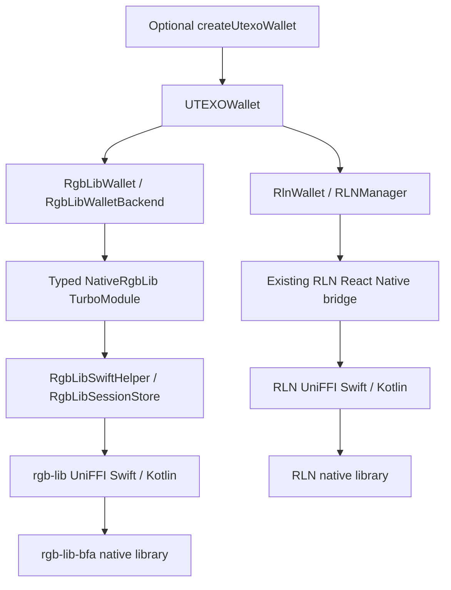

# RLN та rgb-lib-bfa у React Native SDK

`UTEXOWallet` — єдиний публічний facade для обох бекендів.
`new UTEXOWallet(params, signer)` зберігає попередню поведінку RLN.
`new UTEXOWallet({ protocol: 'RGB_L1', params, keys })` додає on-chain режим.
В обох випадках `wallet instanceof UTEXOWallet` повертає `true`.
`createUtexoWallet(options)` залишається необов'язковим скороченням того самого
конструктора; використовувати фабрику для вибору бекенда не потрібно.

Версія rgb-lib-bfa зафіксована на
`v0.3.0-beta.7-upstream-dev-bfa.1`,
commit `ad87acb673262dbc0f2270b5b2e2f0d3db74a65a`.
RLN залишається на `0.17.0-beta.3`. Версії оновлюються незалежно.

## Вибір protocol

Публічне поле `protocol` використовує ті самі значення, що й WebRGB:

| Protocol | Режим | Поточна реалізація |
| --- | --- | --- |
| `RGB_LN` | On-chain та Lightning | RLN |
| `RGB_L1` | Тільки on-chain | rgb-lib-bfa |

Старий `new UTEXOWallet(params, signer)` автоматично обирає `RGB_LN`.
За потреби RLN можна обрати явно:
`new UTEXOWallet({ protocol: 'RGB_LN', params, signer })`.
`wallet.protocol` — read-only getter; після створення зміна режиму потребує
окремої сесії та профілю. `getWalletIdentity()` повертає `{ id, network, protocol }`.

`backend` залишається внутрішнім ідентифікатором реалізації та native storage
формату; у публічних constructor options він заборонений. Наявні storage markers,
каталоги й ключі збережених RLN-профілів ця зміна не перейменовує.

WebRGB `getInfo().protocol` читає значення з wallet. `ready` та `methods` описують
стан provider і доступні операції, а не параметри конструктора. `RGB_LN` саме
по собі не гарантує доступності кожної Lightning-операції: діють обмеження мережі
та конфігурації. Старі RLN wallet ports без `protocol` зберігають fallback `RGB_LN`.

## Приклад

```ts
import {
  UTEXOWallet,
  CallbackRgbLibKeyProvider,
} from '@utexo/rgb-sdk-rn';

const wallet = new UTEXOWallet({
  protocol: 'RGB_L1',
  params: {
    network: 'regtest',
    storageDirPath: '/absolute/app/documents/wallets/rgb-lib/regtest/account-1',
    witnessVersion: 'taproot',
    reuseAddresses: true,
  },
  keys: new CallbackRgbLibKeyProvider(async () => {
    // Read the mnemonic from the application's secure credential store.
    return loadMnemonicFromSecureStore();
  }),
});

await wallet.init();
await wallet.unlock({
  indexer: { type: 'electrum', url: 'ssl://your-indexer:50002' },
  proxyEndpoint: 'rpcs://your-compatible-proxy/json-rpc',
  // Specify the actual chain ID when BFA mint validation needs an EVM RPC.
  // evmRpcUrls: { '1': 'https://your-ethereum-rpc' },
});

const address = await wallet.getAddress();
const identity = await wallet.getWalletIdentity();
const assets = await wallet.listAssets();
const invoice = await wallet.onchainReceive({ amount: 10, assetId });
await wallet.refreshWallet();
await wallet.dispose();
```

`indexerUrl` залишається зручним скороченням: `tcp://` / `ssl://` означають
Electrum, `http://` / `https://` — Esplora. Для Bitcoin Core використовуйте
`indexer: { type: 'bitcoind', url, auth: { username, password } }` або
`auth: { cookieFile: '/absolute/path' }`.

HTTP(S) адреси proxy нормалізуються до `rpc://` / `rpcs://`. Для захищеного
proxy можна передати `proxyAuthKeys: { [endpoint]: ed25519SeedHex }`.
Ці ключі та EVM RPC конфігурація передаються при кожному `unlock`.
Старий RLN `ethRpcUrl` не перетворюється автоматично: новому API потрібен chain ID.

## Архітектура



- RN SDK **не містить власного Rust crate, C ABI dispatcher або patches до rgb-lib**.
  Wallet, RGB/BFA операції, підписання та database реалізовані upstream бібліотекою.
- `UTEXOWallet<TProtocol = 'RGB_LN'>` обирає одну реалізацію в конструкторі й
  делегує їй виклики. Старий тип `UTEXOWallet` зберігає RLN-контракт; новий
  конструктор автоматично виводить `UTEXOWallet<'RGB_L1'>`.
- `OnchainWalletApi<TUnlockParams>` описує спільний контракт. Обидві реалізації
  перевіряються TypeScript-компілятором. `IUTEXOProtocol` зберігає RLN/Lightning API.
- RLN-only методи спільного класу мають `this: UTEXOWallet<'RGB_LN'>`. TypeScript
  відхиляє їхні виклики на rgb-lib; для JavaScript вони повертають
  `UNSUPPORTED_CAPABILITY` до будь-якого native виклику. WebRGB не рекламує
  message signing або Lightning для rgb-lib. Для `AnyUtexoWallet` спочатку
  перевіряйте `wallet.protocol === 'RGB_LN'`.
- TypeScript backend володіє lifecycle, конфігурацією та чергою операцій.
  Платформний bridge викликає згенеровані UniFFI методи напряму, як у RLN.
- Swift/Kotlin session stores утримують wallet/online objects, блокування каталогу,
  SDK-профіль та кеш адреси. Це адаптація життєвого циклу React Native.
- DTO-перетворення та тонкі TurboModule-обгортки генеруються скриптами SDK.
  Великі суми стають десятковими рядками до потрапляння в JavaScript.
- Swift bindings ізольовані у модулі `RGBLib`; його FFI бібліотека — у
  `rgb_libFFI`. Це запобігає конфліктам типів із RLN. Kotlin використовує
  namespace `uniffi.rgb_lib`.
- Нативна rgb-lib бібліотека динамічна. Пакування та лінкування ізолюють її символи
  від RLN; версії UniFFI кожного бекенда залишаються незалежними.
- `src/bindings/rgb-lib/manifest.json` фіксує версію, source revision і UniFFI.
  Installer перевіряє metadata та SHA-256 mobile bundle. UniFFI перевіряє ABI
  своїх згенерованих обгорток при завантаженні.

## Сумісність API

| Група | Поведінка rgb-lib |
| --- | --- |
| `init`, `initialize`, `unlock`, `shutdown`, `reinit`, `dispose`, `destroy` | Збережені назви; типізована конфігурація rgb-lib |
| BTC balance/address/UTXO/send/fee estimation | Збережені методи та числові результати в точному діапазоні JS |
| Assets, NIA/IFA issuance, inflate, receive/send | Збережені методи; native invoice parser зберігає `pk`, `enc`, expiry |
| History, refresh, sync | Реальні IDs/statuses; додаткові `Mint`, `MintRight`, BFA schema |
| Backup | `createBackup`; restore через окрему `restoreRgbLibBackup` перед `init` |
| `getNetworkInfo` | Повертає network; `blockHeight` відсутній, бо цей UniFFI release не експонує відповідний метод |
| Identity | `getWalletIdentity` для обох engines; RLN повертає node pubkey як `id` |
| Lightning/LSP/VSS | Залишаються тільки у RLN |
| `signMessage`, `verifyMessage` | RLN-only: TypeScript відхиляє виклик на rgb-lib; JavaScript отримує `UNSUPPORTED_CAPABILITY` |
| PSBT/begin-end | Відсутні; capabilities не рекламують підтримку |
| `checkIndexerUrl`, `checkProxyEndpoint` | RLN-specific; rgb-lib перевіряє підключення через `unlock` |

`getBfaCapabilities` описує native burn/consignment/BFA. Це **не підтвердження**
сумісності payout bridge. WebRGB для rgb-lib повідомляє `RGB_L1`, не рекламує
`signMessage`, `burnAsset` чи EVM/Tron payout namespaces до окремої перевірки
формату proofs із відповідним bridge. Низькорівневий `burn` доступний;
`burnRecipient` передається як native 32-byte `burn_reason`.

Суми `u64` перетинають native boundary як десяткові рядки. Існуючі числові поля
не округлюються: поза `Number.MAX_SAFE_INTEGER` метод повертає `AMOUNT_OVERFLOW`.
Transfer/assignment мають точне `amountBaseUnits`, а `amount` для великої суми
відсутнє. `feeRate` для цього release має бути додатним цілим sat/vB; дробове
значення відхиляється. Результат `estimateFeeRate` округлюється вгору як рекомендація.

Native `send` сам виконує необхідну синхронізацію; upstream не має його
`skipSync` параметра. Поле сумісності приймається, але не вимикає цю синхронізацію.
Операція send закінчується за 600 секунд до invoice expiry відповідно до margin
цього pinned release; надто короткий залишок часу відхиляється.

## Профілі та lifecycle

Кожен `(protocol, network, account, witnessVersion)` повинен мати окремий каталог.
Профіль зберігає повні account xpubs, network, witness version, max allocations
та детермінований identity; одного короткого fingerprint недостатньо.
Зміна ключів або параметрів існуючого профілю відхиляється.
`utexo` відповідає `SignetCustom`, `signet` — стандартному Signet.

Не переміщуйте RLN database до rgb-lib і не вважайте вибір іншого engine міграцією
активів. Однаковий mnemonic не гарантує однакові похідні ключі чи сумісність
наявних RGB даних. Старі адреси та pending transfers залишаються у старому профілі.
Для переходу потрібен сумісний transfer/restore сценарій, перевірений окремо.

`init` дедуплікується. `unlock` з однаковою конфігурацією ідемпотентний;
зміна конфігурації потребує `shutdown` → `reinit`.
Прийняті операції виконуються послідовно зі знімком вхідних параметрів.
`shutdown` / `dispose` очікують завершення прийнятих операцій і відхиляють нові.
Невдала cleanup залишає ownership за facade, доки повторний cleanup не успішний.
`dispose` остаточний, `shutdown` дозволяє `reinit`.
Помилка відправлення не спричиняє автоматичного повторного send/burn.

OS file lock захищає профіль між native handles і процесами.
Маркери engines відхиляють відкриття RGB Lib сховища через RLN і навпаки.
Кеш адреси входить у native encrypted backup. Restore працює через staging
в окремому порожньому каталозі; невдале розшифрування не займає цільовий профіль.

## Підключення UniFFI-біндінгів

Збірка Rust і публікація mobile artifacts належать репозиторію бібліотеки /
біндінгів. RN SDK лише підключає готові Swift/Kotlin артефакти, аналогічно RLN.
Rust toolchain для встановлення SDK не потрібен.

Для локальної перевірки підготовлений bundle безпосередньо з **незміненого**
UniFFI crate pinned rgb-lib-bfa. Поки відповідний mobile bundle не опублікований,
передавайте його каталог явно; SDK не використовує вигадані release URL або
біндінги від іншої версії rgb-lib.

```sh
npm run bindings:rgb-lib -- --from /path/to/rgb-lib-mobile-bundle
# Або автоматично під час postinstall:
RGB_LIB_BINDINGS_DIR=/path/to/rgb-lib-mobile-bundle npm install
```

Installer підтримує `--platform ios`, `android` або `all`. На macOS за замовчуванням
встановлюються обидві платформи, на інших ОС — Android.
Після встановлення виконайте `pod install` у iOS-застосунку та перебудуйте app.

Очікуваний bundle:

```text
manifest.json
  version / sourceRevision / uniffiVersion / swiftModule / kotlinPackage
  checksums: { "relative/file/path": "sha256", ... }
ios/RGBLib.xcframework
ios/rgb_libFFI.xcframework
android/rgb-lib-bfa.aar
```

`RGBLib` містить згенеровану Swift-обгортку, `rgb_libFFI` — нативну бібліотеку.
AAR містить згенеровані Kotlin-класи та `librgblibuniffi.so` для
`arm64-v8a`, `armeabi-v7a`, `x86_64`. Обидва артефакти мають бути згенеровані
UniFFI **0.32.2** із source revision, зазначеного в SDK manifest.

При генерації Kotlin вкажіть `package_name = "uniffi.rgb_lib"` та
`cdylib_name = "rgblibuniffi"` у секції `[defaults.bindings.kotlin]` конфігурації
bindgen. Ім'я бібліотеки має відповідати `.so` в AAR. Згенеровані Kotlin-класи
зібрані з language/API version 1.9 та JVM target 1.8 для сумісності з Kotlin
версією SDK. Android `.so` мають 16 KB ELF alignment і `-Bsymbolic` для
ізоляції символів від RLN.

iOS artifacts встановлюються в `ios/RgbLibBindings`; Android AAR — у локальний
Maven repository `android/rgb-lib-maven`. Обидва каталоги виключені з Git/npm.
Podspec і Gradle перевіряють версію встановлених bindings перед збіркою.
RLN-only build працює без цих artifacts; `rgb-lib.init()` у такому build повертає
`NATIVE_BACKEND_UNAVAILABLE`. Android не компілює optional rgb-lib bridge без AAR.

```sh
npm test
npm run codegen
npm run test:rgb-lib:ios
```

iOS smoke test використовує справжні UniFFI-виклики: завантажує обидва engines,
створює wallet, перевіряє lease/profile, повторне відкриття, invoice/history,
точну суму понад `Number.MAX_SAFE_INTEGER` та encrypted backup/restore.
Тест створює власний Simulator і видаляє його після виконання.
Він використовує out-of-band receive і не підтверджує роботу конкретного
proxy/indexer deployment або перекази з коштами.

`scripts/native/RgbLibKotlinSmoke.kt` містить аналогічну перевірку Kotlin session
store через UniFFI для JVM: профіль, блокування, invoice/history та backup/restore.
Її локальний запуск використовує desktop UniFFI library того самого revision;
це не замінює запуск React Native застосунку на Android.

## Мінімальний перехід rgb-sdk-rn-demo

Суміжний demo-репозиторій цією зміною не модифікується.
Його поточні точки інтеграції:

1. `utils/wallet/node.ts`: залишити наявний `new UTEXOWallet(params, signer)`
   для RLN. Для rgb-lib додати `new UTEXOWallet({ protocol: 'RGB_L1', params, keys })`,
   окремий storage path та key provider
   поверх SecureStore. Існуюче збереження credentials **перед** native init
   потрібно зберегти.
2. `utils/wallet/types.ts`: використовувати `AnyUtexoWallet` / `WalletTransfer`
   замість прив’язки всього UI до `UTEXOWallet`. On-chain екрани зберігають методи.
3. Account identity: замінити `getNodeInfo().pubkey` на `getWalletIdentity().id`.
   Для `RGB_L1` додати protocol до ключів SecureStore, WalletConnect session storage,
   burn journal і кешів; існуючі RLN ключі залишити сумісними.
4. `utils/wallet/service.ts`: при перемиканні спочатку завершити requests,
   зупинити polling, відкликати sessions та `dispose` попередній facade.
   Після cleanup створити facade нового профілю. Не переносити pending transfers
   або burn journal між engines.
5. Lightning/LSP UI відкривати лише після `wallet.protocol === 'RGB_LN'`.
   WebRGB provider приймає обидва wallet; список можливостей брати з `getInfo`.
6. Перед увімкненням rgb-lib у demo явно задати сумісні proxy/indexer та EVM chain
   IDs. Провести receive → send → refresh, перезапуск із pending transfer і
   відновлення backup на тестовому deployment.

Приклад фабрики сесій: [`examples/dual-backend.ts`](../examples/dual-backend.ts).
